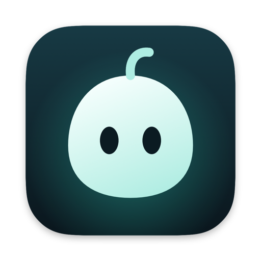

  

<h1 align="center">Gon</h1>

  <b>Your Mac, light again.</b> 
  A native macOS cleaner and system utility that shows you every item before anything goes to the Trash.

  <a href="https://github.com/caalabs/gon-app/releases/latest/download/Gon.dmg"><b>Download</b></a> ·
  <a href="https://caalabs.github.io/gon-app/">Website</a> ·
  <a href="https://github.com/caalabs/gon-app/releases">All releases</a>

---

Gon tidies up after your Mac: app caches, build leftovers, old logs, installers you no longer need, and the files
apps leave behind after you delete them. It explains each item, puts it in the Trash where you can get it back,
and keeps its hands off anything that might be yours.

**Free · macOS 14 or later · Apple silicon · No account**

## Install

1. [Download Gon.dmg](https://github.com/caalabs/gon-app/releases/latest/download/Gon.dmg), the latest version (every version is under [Releases](https://github.com/caalabs/gon-app/releases)).
2. Open it and drag **Gon** into **Applications**.
3. Open Gon. It isn't notarized by Apple yet, so the first time macOS stops it. Go to
   **System Settings › Privacy & Security**, find the message about Gon near the bottom, click **Open Anyway** and
   confirm. You only do this once.
4. For complete scans, turn Gon on in **System Settings › Privacy & Security › Full Disk Access**. Gon works
   without it, but some caches and leftovers stay out of its sight.

After that, Gon updates itself (see [Updates](#updates)).

## What it does

| | |
|---|---|
| **Clean** | Caches, logs, build leftovers, old installers and the Trash, each with what it is and what happens if it goes |
| **AI Tools** | Caches and old builds of AI coding tools; old chats and finished git worktrees for you to review |
| **Apps** | Uninstalls an app with everything it left behind, manages what starts at login, checks for and installs updates |
| **Analyze** | A map of your disk with the largest files beside it; can look for duplicate files in a folder |
| **Optimize** | Maintenance and quick fixes, with one password prompt for everything that needs one |
| **Status** | Live CPU, memory, disk, network, battery and temperatures, every process, and a health score |
| **Doctor** | A checkup: how your Mac is in one sentence, then the list of what needs you |
| **Menu bar** | Gon hops faster as your Mac gets busier, next to the readings you pick; top processes, eject, Keep Awake |

## How Gon stays safe

- **Nothing goes without your review.** Items are sorted into **Safe** (selected for you), **Review** (shown,
  never selected for you) and **Manual** (information only).
- **The Trash by default.** What Gon removes goes to the Trash, files that need an administrator included, so you
  can put it back. Deleting for good always asks first.
- **Hands off what's in use.** A cache stays while the app or tool that writes it is running, and a file another
  app has open is skipped.
- **Your places stay yours.** System folders, Keychains, Mail, Messages, `.ssh`, your documents and anything you
  mark *Never clean* are never offered.
- **A record of everything.** Every removed or skipped item is logged. Open the log from
  **Settings › About › Show Operations Log**.

## Updates

Gon checks for a new version every six hours. When one is out, a small note appears in a corner of its window: one
click downloads it, a second restarts into it. You can check by hand from **Gon › Check for Updates…** or turn
automatic checks off in **Settings › About**.

Every release is signed, and Gon refuses an update whose signature doesn't match.

## Privacy

Gon has no account and sends no analytics. It goes online only to:

- check for its own updates, from this repository's update feed;
- check your apps for updates, when you open **Apps › Updates**;
- ask the assistant you picked, if you turn the assistant on.

The assistant is optional and off until you choose one. With **Apple Intelligence** or a model server running on
your Mac (**Ollama**, **LM Studio**, **Jan** or **GPT4All**), nothing leaves your Mac. A custom server gets your
question wherever you point it. With **Claude Code**, **Codex** or **Gemini CLI**, your question goes to that
service under your own account, and Gon asks before the first time.

## Report a problem

[Open an issue](https://github.com/caalabs/gon-app/issues/new). It helps to include:

- your Gon version (**Settings › About**) and macOS version;
- what you did and what you expected;
- the related lines from the operations log, if something was removed or skipped.

## About this repository

This is Gon's public home: the website, the downloads and the update feed. The app's source lives elsewhere.

| Path | What it is |
|---|---|
| `index.html`, `assets/` | The website, served by GitHub Pages at [caalabs.github.io/gon-app](https://caalabs.github.io/gon-app/) |
| `appcast.xml` | The update feed installed copies read. The release script adds each version; don't edit it by hand |
| [Releases](https://github.com/caalabs/gon-app/releases) | The signed `.dmg` for each version |

The website loads nothing from other sites. It ships [Motion](https://motion.dev) 11.11.17 (MIT) in
`assets/js/motion.min.js` and the Sora typeface (SIL Open Font License, `assets/fonts/Sora-OFL.txt`). Visitors who
ask for reduced motion get the page at rest.

---

Copyright © 2026 CaaLabs

